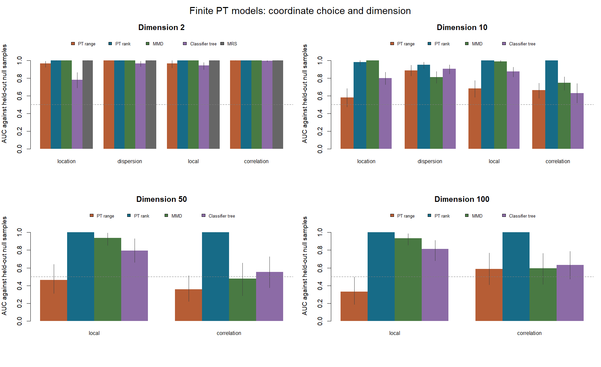
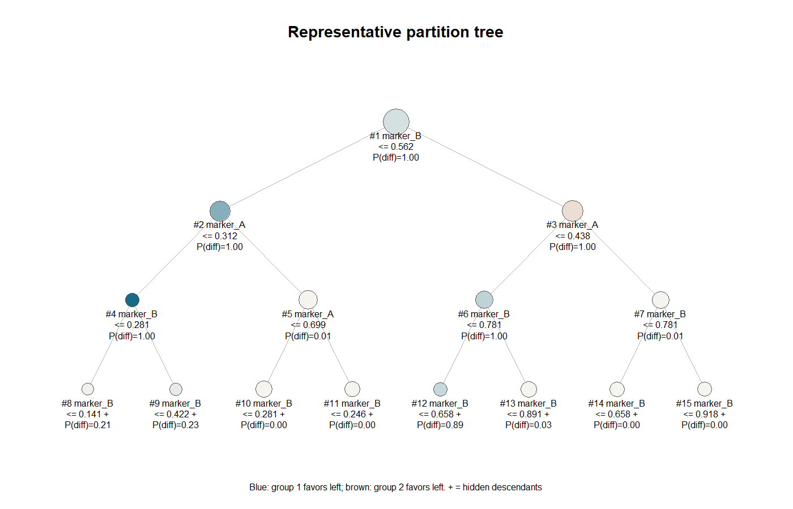

# ptcompare 0.0.1 実装・評価レポート

評価日: 2026-09-15。R 4.5.2 / Windows 11 x64、Intel Xeon w5-3423（24論理プロセッサ）で実施した。パッケージのC++計算は単一スレッドである。

## 実装した範囲

二標本専用のR APIとC++17エンジンを実装し、固定木・小規模適応木の厳密計算による検証、代表木と局所領域の説明、計算診断、反復シミュレーションまで完了した。RStudioで実行できる4本の例を同梱し、このPCのプロジェクト専用ライブラリにインストールしている。CRAN提出は実施していない。

モデルは有限深さのhidden Markov Pólya treeであり、差あり・共有・吸収共有の3状態を使う。SMCの各更新では、既に展開した兄弟枝の情報を含む部分木の厳密な尤度を使用する。分割位置には有限格子の事前を使い、旧コードの吸収的な中点固定は採用していない。詳細は [統計仕様](../inst/STATISTICAL-SPECIFICATION.md) に記載した。

線形の共通変換 `transform="range"` に加え、二群共通の順位座標 `transform="rank"` を実装した。順位変換を追加した理由は、線形座標の浅い木では、無関係な変数の周辺分布を表現する分割に計算と深さが使われ、群間差を見落とす例が多かったためである。順位変換は原尺度上の分割事前と末端分布を変更し、推定した変換に条件付けて推論する。一般の完全ベイズモデルにおける変換の不確実性は積分していない。評価後、supportを省略した一般利用ではrankを既定にし、既知のsupportを指定した場合はrangeを既定にした。以下の比較実験は両設定を明示しており、この既定値変更で結果は変わらない。

## 数値的な正しさ

固定された7ノードの木では、内部3ノードの全27状態を独立なRコードで列挙し、周辺尤度、全体帰無確率、各ノードの差の事後確率がC++のmessage passingと1e-11の許容誤差で一致した。遷移行列の深さ依存が異なる複数設定を検証している。

さらに、2変量・3分割候補・深さ2の216個の適応木を列挙し、各木の状態も全列挙した分布をSMCの検証基準とした。再標本化を行わない場合と、頻繁に行う場合の両方で、全体帰無確率、尤度、木の事後重みを比較した。独立seedによる追加48実行では、粒子数を64から4,096へ増やすと、全体帰無確率の平均絶対誤差は0.00484から0.00077、木の事後分布の平均total variation距離は0.720から0.099へ低下した。

| 粒子数 | 全体帰無確率の平均絶対誤差 | 木の事後分布の平均TV距離 |
| ---: | ---: | ---: |
| 64 | 0.00484 | 0.720 |
| 256 | 0.00306 | 0.387 |
| 1,024 | 0.00165 | 0.194 |
| 4,096 | 0.00077 | 0.099 |

全体帰無確率のような集約量は、木の分布全体より少ない粒子でも安定し得る。この結果は、全体確率が安定していることだけで、説明木の不確実性まで十分に解消したと判断できないことも示している。[個々の誤差](results/exact-convergence.csv) と [図](figures/exact-convergence.png) を保存した。

群交換、行順序の変更、同値・端点、線形変換の逆変換、順位変換後の原尺度での領域所属、定数列、非有限値、極端に細い領域、図の生成もテストした。局所効果の要約と描画はRの乱数状態を消費しない。旧プログラムの出力との一致は検証基準にしていない。

## シミュレーションの設定

1,220組のデータにrangeとrankをそれぞれ適用し、合計2,440回の推定を行った。ここでは軽量な評価設定として、粒子64、最大深さ6、分割候補7、min_node=20、効果量積分256点を使った。gamma=0.3、beta=1、prune=0.3、precision=1、eta=0.1である。通常のAPI既定値は粒子256、深さ8、候補15、積分4,096点であり、以下の性能を既定値そのものの評価とは扱わない。

基本設定は各群300観測で、独立な標準正規変数を用いた。位置差は群2のX1へ0.5を加え、分散差はX1の標準偏差を1.7倍にした。局所差はX1が標準正規分布の35%点より小さい場合だけ群2のX2へ1.3を加えた。相関差は群2のX1とX2の相関を0.8とし、両群の各周辺分布は同じ標準正規に保った。追加変数は独立な無関係変数である。

2・10変量では各200回の帰無データと、各対立50回を用いた。50・100変量では帰無40回、局所差・相関差を各25回とした。10変量では、t(3)分布に位置差0.8を加える裾の重い設定と、群サイズ120対600で位置差0.5を加える不均衡設定も検討し、それぞれ帰無80回・対立40回を用いた。

比較対象は、共通標準化とmedian bandwidthを用いるGaussian MMDの不偏U統計量、60%の訓練標本と独立な40%の評価標本を使うrpart分類器の正解率、2変量でのMRS 1.3.2（K=6、alpha=0.5、その他は標準設定）である。分類器では群サイズをそろえて訓練・評価した。MRSとは有限木や事前の仕様が完全に同一ではなく、分類器も単純な比較用ベースラインである。各手法を網羅的に調整した最良性能の比較ではない。

### 識別性能

次表は対立と独立な帰無検証データを区別するAUCである。AUCは0.5が無識別、1が今回の標本で完全に順位分離した状態を表す。

| 次元・差 | PT range | PT rank | MMD | 分類木 |
| --- | ---: | ---: | ---: | ---: |
| 2・位置 | 0.965 | 0.998 | 1.000 | 0.779 |
| 2・局所 | 0.964 | 1.000 | 1.000 | 0.942 |
| 10・位置 | 0.582 | 0.979 | 1.000 | 0.801 |
| 10・分散 | 0.885 | 0.949 | 0.809 | 0.903 |
| 10・局所 | 0.683 | 1.000 | 0.989 | 0.873 |
| 10・相関 | 0.662 | 1.000 | 0.746 | 0.630 |
| 50・局所 | 0.464 | 1.000 | 0.938 | 0.792 |
| 50・相関 | 0.358 | 1.000 | 0.476 | 0.552 |
| 100・局所 | 0.332 | 1.000 | 0.934 | 0.813 |
| 100・相関 | 0.588 | 1.000 | 0.594 | 0.632 |
| 10・裾の重い位置差 | 0.568 | 1.000 | 1.000 | 0.804 |
| 10・不均衡な位置差 | 0.623 | 0.886 | 0.986 | 0.602 |

rangeでは次元が増えると弱い識別性能となり、rankで大きく改善した。特に、依存構造だけの差と局所差では、共通順位座標にすることで関連変数の分割に木を使いやすくなった。一方、不均衡な位置差ではMMDのAUCが高く、rankにも改善の余地が残る。2変量のMRSは位置差・分散差でAUC 0.998、局所差・相関差で1.000となり、低次元では十分競争力があった。

各AUCの400回bootstrap区間と、判定率の二項95%区間を [全比較表](results/comparison.csv) に保存した。50・100変量のAUCは対立25回・帰無検証20回という小標本に基づく。AUC=1やbootstrap区間[1,1]は観測標本が分離した結果であり、一般のデータに完全な識別を保証しない。ここでの対立は明確な差を持つ設定であり、微弱な差への検出限界は今後の課題である。

### 事後確率の閾値と帰無時の挙動

固定の判定規則P(different)>0.95を適用すると、rankの判定率は10変量の位置差84%、分散差76%、局所差98%、相関差100%であった。100変量では局所差・相関差とも88%となった。これらは事後確率閾値の挙動であり、有意水準5%の検定としての検出力ではない。

| rankの帰無設定 | 0.95超過数 | 超過率 | 超過率の二項95%区間 |
| --- | ---: | ---: | ---: |
| 正規・2変量 | 1/200 | 0.5% | 0.013–2.75% |
| 正規・10変量 | 0/200 | 0% | 0–1.83% |
| 正規・50変量 | 0/40 | 0% | 0–8.81% |
| 正規・100変量 | 0/40 | 0% | 0–8.81% |
| t(3)・10変量 | 1/80 | 1.25% | 0.032–6.77% |
| 不均衡・10変量 | 1/80 | 1.25% | 0.032–6.77% |

rangeではこれらすべての帰無設定で0.95超過がなかったが、対立の見落としも多い。帰無で低い超過率を得たことだけを性能の根拠にはできない。[帰無の集計](results/posterior-threshold-null.csv) を別に保存した。

比較用に、帰無反復の前半で閾値を設定し、後半で偽陽性率を確認する評価も行った。校正標本数mに対してceil(0.95*(m+1))番目の順序統計量を閾値とし、超過を判定した。rankの観測偽陽性率は、2変量で9/100、10変量で5/100、50変量で3/20、100変量で0/20となった。少数の校正・検証標本による変動が大きいため、これらの判定率を既知の5%偽陽性率の下で比較した値とは解釈しない。この閾値設定はシミュレーション内の比較用であり、パッケージのp値機能としては提供していない。

## 説明の妥当性と安定性

局所差シミュレーションでは、真のゲートX1<qnorm(0.35)と返された領域の重なりを、標準正規基準分布でのJaccard係数として計算した。rootを除き、観測数30以上の領域を局所事後確率で順位付けした。最上位領域の平均Jaccardは、rangeからrankへ変更すると2変量で0.255→0.491、10変量で0.283→0.450へ改善した。100変量では0.180→0.237にとどまり、全体の差を検出できても、その原因となる領域を一つの矩形で十分に説明できるとは限らなかった。

上位5領域の中で真のゲートと最も重なる領域を選ぶ参考値も保存した。これは真の領域を知った上で選ぶ評価値であり、利用者が自動的に同じ領域を選べることを意味しない。[局所領域の集計](results/localization.csv) に両指標を分けて記載している。

RStudioの局所差の例は、各群1,000観測、marker_A<0.35の群2だけmarker_BをBeta(5,1)へ変更したデータである。P(local difference)>0.9、観測数40以上で抽出された5領域について、生成分布から真の条件付きlog odds ratioを直接計算した。推定の符号は5領域すべてで一致し、真の効果もすべて95%信用区間内に入った。例えばmarker_B<=0.5625の領域におけるmarker_A<=0.3125の分割では、真の効果2.251に対し推定2.294、区間[1.783, 2.859]であった。これは単一の動作例であり、一般的な95%被覆率の検証ではない。[数値表](results/example-true-effects.csv) を保存した。

同じ10変量の位置差データで粒子数64・256・1,024を各6seedで実行した安定性試験では、rangeの全体事後確率は約0.23–0.24で安定していたが、最上位の説明変数は真のX1と異なるX6であった。深さ4・6・8、格子3・7・15を変えた追加試験でも、この例の検出は改善しなかった。安定した数値が有用な説明を保証しない例として [安定性](results/stability.csv) と [モデル感度](results/model-sensitivity.csv) を残した。

別のRStudio高次元例では、20変量でX1に位置差を加えたところ、rangeのP(different)=0.037に対しrankでは0.99986となり、rankの代表木の最上位分割はX1であった。説明用の閾値は元の単位で表示される。rankの利点を示す一例として参照できる。

粒子のroot ancestorが1〜数個まで減る例は多い。ESSだけで収束を判断せず、独立seed、粒子数、座標変換を比較する必要がある。局所信用区間は代表木に条件付けたもので、木の選択を含む不確実性は積分していない。

## 計算時間とメモリ

重みの正規化と再標本化を線形時間にし、分割候補の集計をヒストグラムと累積和に変更した。観測添字を葉のブロックとして共有し、粒子が同じ木を持つ間は候補計算も共有する。全粒子の境界配列をRへ返す処理は既定で省いている。

以下は別のRtermプロセスをケースごとに起動し、他の評価処理を終了させた状態で測った結果である。深さ6、候補7、積分256点の固定予算であり、各ケース1回の測定である。時間はcompare_pt全体、メモリはWindowsのpeak working setで、R本体、入力データ、前処理、結果なども含む。Rscriptランチャーのメモリとは区別して、計算を行うRterm自身を測定した。

| 総観測数 | 次元 | 粒子 | 座標 | 時間 | 最大working set |
| ---: | ---: | ---: | --- | ---: | ---: |
| 1,000 | 2 | 64 | rank | 0.28秒 | 94 MiB |
| 1,000 | 10 | 64 | rank | 0.47秒 | 92 MiB |
| 1,000 | 50 | 64 | rank | 1.44秒 | 100 MiB |
| 1,000 | 100 | 64 | rank | 2.65秒 | 108 MiB |
| 10,000 | 20 | 64 | rank | 1.36秒 | 143 MiB |
| 50,000 | 20 | 32 | rank | 2.39秒 | 171 MiB |
| 200,000 | 20 | 32 | rank | 10.56秒 | 369 MiB |
| 200,000 | 20 | 32 | range | 2.37秒 | 273 MiB |

20万観測のrankで、保持されたC++粒子構造の計測値は約24.5 MiBだった。ただし、これは過渡的な割り当てやR側のメモリを除く値である。利用者が必要とする総メモリの目安にはworking setを参照する。粒子32・深さ6での実行可能性を確認した結果であり、その予算であらゆる20万観測データを十分に推論できるという意味ではない。実際、同じ大規模ベンチマークのrangeでは、真の位置差に対する事後確率が低い例があった。

単独の計算核でも、元の二乗正規化と線形正規化、suffix加算とヒストグラム累積和の一致を確認した。測定値は [kernels.csv](results/kernels.csv) にある。これは単純化した計算核同士の比較であり、旧HMPTパッケージ全体に対する速度倍率ではない。旧パッケージの不整合を残した実行時間との全面比較は行っていない。

RStudio用の既定設定で4本の例を実行し、1番目は約11秒、2番目は計約6.5秒、3番目の9回の推定は計約28秒、4番目は計約18秒だった。これらの例の測定時には他の評価処理が走っており、参考値である。[個別ログ](results/examples.log) と [時間](results/example-times.csv) を保存した。

## 現時点での利用方針と残る課題

既知の範囲を持つ低次元のデータはrangeから試せる。無関係な変数が多い場合、裾の重い場合、rangeで検出や説明が不自然な場合はrankを比較することを勧める。rankは今回の実験で良い結果を示したが、追加はrangeの弱点を観察した後に行っており、完全に事前登録された独立の確認試験ではない。新しいデータ生成設定、より弱い差、実データでの追試が必要である。

次の開発課題は、木の選択を含めた説明の不確実性、粒子の系譜退化への対策、不均衡標本での感度、より十分な高次元の帰無反復、実データでの確認である。p値、対応のある標本、患者単位の階層モデル、交絡調整、多群比較は今回の機能に含めていない。

Windowsの最終R CMD check（manualとvignette生成を省略）はStatus: OKで、インストール、文書整合性、実行例、全テストを確認した。テストは86項目成功、失敗・警告・skipはいずれも0だった。[チェックログ](results/R-CMD-check.log) と [テストログ](results/testthat.Rout) を保存した。Linux/macOS、R-devel、sanitizerを含むCRAN提出前の検証は後続段階に残る。

## 再実行に必要なファイル

- `evaluation/run-study.R`: rangeと比較手法。CSVの未完了行から再開する。
- `evaluation/run-rank-study.R`: 同じデータ・seedでのrank比較。
- `evaluation/run-verification.R`: 全列挙との比較、粒子数とモデル感度。
- `evaluation/check-example-effects.R`: 局所例の真の効果との比較。
- `evaluation/summarize.R`: AUC、判定率、区間、局所指標、図の生成。
- `evaluation/run-benchmarks.ps1`: Windowsのプロセス別時間・メモリ測定。
- `evaluation/render-examples.R`: 4例を実行して図と結果を保存する。

全実験の元のseedは [study.csv](results/study.csv)、対応するrank結果は [rank-study.csv](results/rank-study.csv)、R環境は [session-info.txt](results/session-info.txt) に保存してある。
